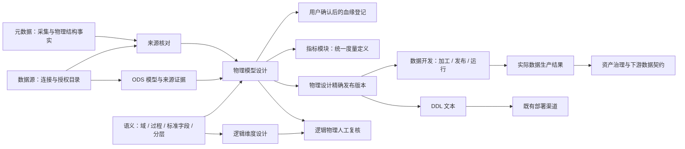

# 模型工作台：完整数仓建模体验重设计提案

Status: DRAFT\
日期：2026-10-14\
范围：ODS / DWD / DIM / DWS / ADS 全层纳管、逻辑到物理设计、跨模块交接及独立 HTML 原型；不修改生产前后端。\
原型：[打开 HTML](../../../data-ops-ui/src/pages/modeling/prototype/dimensional-modeling-prototype.html)

## 1. 产品判断

建议把模型工作台组织成覆盖完整数仓的专业设计环境，以业务过程和应用需求组织 ODS、DWD、DIM、DWS、ADS。用户既能从源表进入，也能从业务粒度或应用需求进入；各层完成不同设计任务，最终形成独立物理模型和精确结构版本，交给原有接入、开发与消费模块。

默认采用“分层全景 → 按层专业编辑”的持续工作台，保留覆盖五层的任务引导，以及“业务过程 × 分层 / 公共维度矩阵”。维度建模主要用于 DWD/DIM 的业务设计，统一纳管覆盖整个数仓；ODS 保留来源结构，DWS 明确聚合，ADS 服务应用。三种结构使用同一份设计上下文，不新增一级产品域或业务事实库。

设计不参考旧页面布局。现有 Product / Domain Contract 用于确定边界，接口代码仅作为兼容性证据。正式替换页面前仍需形成 APPROVED Feature Spec；本文件及原型不改变当前 Product Truth。

## 2. 必答问题

| 问题 | 本次回答 |
|---|---|
| User / 用户 | 数仓建模工程师为主；数据开发工程师、业务分析师、数据治理人员参与复核 |
| Problem / 问题 | 用户已反馈当前交互别扭、难用。待验证的原因是假定用户先理解页面和技术对象，再自行串联粒度、关系、来源、标准和交付；本轮没有做旧 UI 可用性诊断 |
| Capability / 能力 | 在现有“标准、指标与建模”中统一管理五层模型，完成各层业务设计、逻辑物理复核、版本交付与原模块回链 |
| User Journey / 旅程 | J2 的业务域/过程 → 标准 → 模型，并承接 J1 的来源 → 模型 → 数据开发 |
| Expected Outcome / 结果 | 用户能找到每个模型所在层、业务粒度、上游和下游，解释事实/维度/聚合/应用含义，交付精确物理版本；开发人员能知道接入、历史、连接与聚合还缺哪些规则 |
| Truth Owner / 事实归属 | Semantic：域、过程、标准字段和分层；Modeling：逻辑/物理结构、映射和版本；Datasource/Metadata：连接及目录/采集事实；Development：加工定义、发布和运行；Asset/Lineage：各自治理事实 |
| Producer / 生产方 | 建模人员产生设计；来源系统产生原始数据；Semantic 产生标准；源域公开查询产生引用证据 |
| Consumer / 消费方 | 数据开发消费设计/SQL 草稿；Metric 消费模型引用；Asset/Lineage 消费登记及投影；分析侧通过 Dataset/Data Service 消费实际数据 |
| Reuse / 复用 | Project、RBAC、Semantic 标准与过程、分层配置、目录元数据、模型结构校验、CAS 保存、版本、现有审批、数据开发、审计、血缘、资产 |
| E2E acceptance evidence | 第 12 节规定原型走查和未来真实系统验收，分别记录，不把演示行为当成真实闭环 |

## 3. 维度建模业务逻辑

### 3.1 先确定过程与粒度

选择 Semantic 已有业务域与业务过程；没有过程时跳转其所属模块创建并回到当前上下文。工作台不创建第二套过程。

用户回答：

1. 要分析哪个业务事件，例如订单交易、退款、库存？
2. 一行数据究竟代表什么，例如“一张订单的一条商品明细”？
3. 用哪些业务字段唯一识别这一行？
4. 记录发生时刻、周期快照还是过程累计结果？

粒度首先是一句可理解的业务声明，再选择识别字段。复合主键、代理键、分区、GROUP BY 都不能替代业务粒度说明。平台可以检查字段是否存在，业务语义仍需人工确认。

事实模式：

| 模式 | 示例 | 设计重点 |
|---|---|---|
| 事务事实 | 每条订单商品明细 | 最细事件粒度、事件时间、可加性 |
| 周期快照 | 每日每仓每商品库存 | 观测周期；余额通常不能跨时间求和 |
| 累积快照 | 每个履约单的处理进度 | 多个里程碑日期；更新/重算策略交给数据开发 |
| 无事实事实 | 每个用户参与一次活动 | 记录发生关系，没有必须存在的数值度量 |

完整原型以订单交易贯穿五层，DWD 星型编辑器演示订单商品明细。周期快照、累积快照与无事实事实可在事实模式中讨论约束，不宣称已经实现这些模式的自动加工。

### 3.2 声明事实与维度

一个星型设计通常以一张事实表为中心，引用多个维度。一个业务过程可以需要多种粒度的事实设计，不能将其压成一张万能表。

- 事实字段区分业务标识、维度引用、度量和技术字段。
- 订单编号等退化维度保留在事实中，不为没有属性的编号另造维表。
- 订单明细粒度的支付金额、数量可以成为度量；订单总额不能在每条明细上重复计入总和。应选择明细金额、经过明确口径的分摊，或另建订单粒度事实。
- 度量分别声明单位、含义和可加性；比率通常先保留分子/分母，再由指标模块定义计算，避免默认把比率求和。
- 周期汇总属于 DWS 的结构化聚合，不把每个明细事实字段都加上 SUM。
- 度量字段是模型结构；正式指标的口径、版本和发布仍归 Metric。

### 3.3 优先复用公共维度

选择维度时先搜索当前项目已经存在的逻辑实体/物理维度模型，显示定义、标准字段、可用版本和被引用的业务过程。引用使用稳定 ID，名称只是展示。

“公共维度库”是搜索/组合视图。当前没有证据表明存在独立维度注册库，不能新建一套维度定义并复制模型。

每个维度至少讨论：业务键、代理键、属性、层级、历史策略、未知成员、迟到数据，以及关系基数。

| 情况 | 体验与规则 |
|---|---|
| 角色扮演维度 | 同一个日期维度可作为下单日期/支付日期，以关系角色区分，避免复制日期定义 |
| 缓慢变化维度 SCD1 | 覆盖属性；确认是否接受失去历史属性 |
| 缓慢变化维度 SCD2 | 明确跟踪属性、有效区间、当前标记；事实按事件时间命中版本，由开发实现区间查找与冲突处理 |
| 多对多维度 | 不能直接用 1:N 替代；提出桥接与分摊设计，再进入产品/领域评审 |
| 未知/迟到成员 | 给出待设计提醒；默认键值不能凭空规定为企业级规则 |
| 层级 | 可展开说明，例如省→市→区；持久化与钻取能力未核实前不宣称可执行 |

符合名称或字段相似不等于一致性维度。共享粒度、业务键、属性含义和标准需要人工核对。矩阵帮助看见复用范围，不自动裁决一致性。

### 3.4 关系需要语义和证据

画布同时显示“维度 1 → 事实 N”的设计关系和连接字段。编辑关系使用表单选择两端字段、基数和角色，拖线只是快捷入口。

逻辑 API 当前只表达实体端点与基数；没有字段对、角色、时间区间规则的完整写入证据。原型中的这些信息属于设计提案，不能在生产前端中伪装为已经持久化。

基数声明是设计意图，未经数据剖析不得标成“数据验证通过”。多维表连接造成扩行、SCD 区间交叉、事实重复行都需要真实数据验证；前端不能从几根连线判断正确。

### 3.5 完整分层纳管与各层的设计任务

“完整”指用户能在同一个工作台找到并设计五层模型、理解其依赖、发布独立结构版本、继续到原有模块完成生产。它不要求每个需求都创建五层，也不意味着建模模块负责执行接入、加工和消费。

| 分层 | 一行代表什么 | 设计入口与任务 | 输出与下一步 |
|---|---|---|---|
| ODS | 来源系统中的一条记录，遵循源表本身的粒度 | 从授权目录选择表；预览来源字段/主键/类型；确认目标结构、技术列和单列映射；查看当前源结构差异 | 一表一物理模型、明确 sourceRef 与当前映射；交给接入模块配置全量/增量、CDC 和落表 |
| DWD | 明确业务过程下的一条明细事件或一个快照 | 先粒度，再事实模式、业务标识、符合粒度的度量、清洗与共享维度引用；来源优先核对 ODS | 可解释的事实设计与明细物理模型；交给数据开发实现清洗、查维、幂等与重算 |
| DIM | 维度成员的当前属性，或一段有效区间内的属性版本 | 业务键、代理键、属性、层级、SCD 策略、角色复用和未知成员；查找现有维度优先 | 单独维度模型及精确结构版本；交给数据开发实现维度加载与历史处理 |
| DWS | 指定统计周期、指定分组维度组合的汇总结果 | 选择 DWD 上游模型；分组维度、周期日期转换、度量和聚合函数；核对可加性与多上游连接 | 聚合结果结构、当前分层映射与汇总设计；交给数据开发实现计算、连接和重算窗口 |
| ADS | 应用需要的一个结果粒度，例如每日每商品每渠道的经营结果 | 应用目标、appCode/appName；选择 DWS 或明确从 DWD 取数；核对字段、必要聚合与交付用途 | 应用模型及结构版本；交给数据开发形成实际数据，再由 Dataset/Data Service 承载治理消费 |

分层引用 Semantic 已有 LayerConfig，不在模型页维护第二套分层。原型按常见的五层展示，正式页面的排序、显示名、目标库/方言和支持范围来自当前配置；未配置或不支持的自定义层如实提示。

### 3.6 ODS：先准确接入结构，持续核对来源

ODS 有两个起点：从授权目录逆向导入，以及已有 ODS 模型人工确认来源字段。流程为数据源 → 库/schema → 勾选源表 → 预览字段/目标命名 → 确认导入 → 逐表回执 → 打开模型或继续配置接入。

- 预览只读，不创建模型或任务。模型编码、落地表名和来源表名分别显示。
- 批量导入逐表独立报告 created / skipped / failed。成功项保留，失败项重读来源后重试，编码或来源冲突不能自动覆盖。
- 已有 ODS 使用 `ods-manual-import` 的结构/来源/映射统一命令，不在前端拼成三个“原子保存”。正式请求包含预览的源列证据和模型基线，由服务端重读裁决。
- 新增来源字段、类型变化或字段缺失只提示。人工选择后才修改当前草稿，已发布版本保持只读。
- 来源 FORBIDDEN / UNAVAILABLE 不能显示成零字段或“结构一致”。保留已保存结构和映射，但当前源结构无法核对。
- `source-evidence-review` 只能说明当前来源和指定结构版本的比较；历史来源没有冻结，不可把本次读取结果当成发布时源库快照。
- 技术列遵守当前后端分层约定，不在前端另造一套列名。接入方式、调度、运行和真实落表由对应模块负责。

### 3.7 DIM：共享身份、属性与历史，引用范围可见

DIM 是独立物理模型，可以被多个事实模型引用，不附属于某张 DWD 表。工作台先搜索现有维度，再决定复用或新增；引用现有版本不会复制属性定义。

维度设计页同时显示业务键、代理键、属性、历史策略和下游引用。SCD1 覆盖属性；SCD2 保留历史区间，并显示约定字段预览。历史跟踪属性、层级、未知成员与迟到成员是需要明确的设计语义；现有 `scdType` 和约定列只能承载其中一部分。

改变公共维度设计后，显示直接事实引用与传递到 DWS/ADS 的影响范围。下游草稿和已发布快照不会自动重写；引用角色与精确维度版本若无持久合同，标为当前核对上下文或版本未知。

### 3.8 DWS：汇总粒度必须能解释每一行

流程为选择上游 DWD → 核对源字段 → 选择统计周期 → 选择分组维度 → 配置度量函数 → 预览结果字段/主键 → 分别保存结构和分层映射 → 发布并交开发。

当前派生合同可复用 `upstreamModelIds / statPeriod / fieldRole / aggregateFunc / transformExpr`。角色 DIMENSION 表示分组，MEASURE 必须给出服务端白名单函数；DWS 默认主键来自全部分组字段。来源是上游模型，使用分层映射，不能写入只支持数据源表的单列映射。

周期参数不是完整时间加工规则。周/月汇总必须核对日期分桶、时区、周起点、财年与截点；保留日键同时声明周周期会得到更细结果，应提醒。原型允许选择“按周期起始日期键分组 / 保留明细日期”，转换仍是开发待办，不伪造已执行的 SQL。

度量规则：

- 可加度量可按正确分组 SUM；余额不能跨时间轴默认 SUM。
- COUNT_DISTINCT 的分组结果不能任意再 SUM 得到全局去重数。
- 比率保留分子/分母；AVG 再聚合需要权重或底层分子/分母。
- 多个上游模型先确认各自粒度，连接键、基数和重复行由加工阶段处理。不能仅因勾选多张表就宣布连接正确。
- 正式业务口径与指标发布仍归 Metric，模型的聚合列不成为第二份指标定义。

### 3.9 ADS：应用结果与公共汇总分工清楚

默认从 DWS 复用结果，也允许通过已有 `upstreamLayer=DWD` 明确选用明细。切换上游层需明确确认受影响字段，再重新选择候选；应用名称与目标保留，旧映射不能静默指向新源。

ADS 明确应用编码/名称、分析目标、输出粒度、字段与必要计算。当前接口以聚合角色/函数表达派生，不能把它包装成已经实现任意多表 JOIN、任意 SQL 投影或完整应用开发。多上游连接与复杂表达式转到数据开发。

选择 DWS 时核对：上游粒度能否支持应用结果；上游周期是否粗于下游；去重计数是否跨组重算；比率/均值是否保留计算依据。周汇总无法还原日明细，需要换源；商品级去重订单数无法跨商品 SUM 得到全局订单数。

`appCode/appName` 是现有松散绑定，不创建新的应用注册库。查询权限、服务发布、消费调用和运行证据继续由 Dataset/Data Service/消费域负责。

### 3.10 五层统一管理合同

- 稳定模型身份、项目隔离、业务过程与分层归属、标准字段引用、物理结构、草稿和不可变版本使用现有 Modeling/Semantic 合同。
- 每张物理表单独保存和发布；工作台上下文不是跨模型原子发布单或新的业务容器。
- 来源映射、分层映射、设计关系、血缘和实际使用分别呈现。全景箭头表示常见顺序，详情显示实际声明依赖；可从 DWD 直接交 ADS，DIM 可跨过程共享。
- 上游版本变化提示下游重新核对，不自动升级引用或改写设计。当前精确跨模型版本冻结不完整，界面不能补造证据。
- 本轮不新增一套“建模进度”状态机。设计保存、发布版本、部署事实、接入/加工任务和运行结果各读取其 Owner；未知时明确显示。
- 当前 `standard-coverage` / `datadev-handoff-readiness` 合同限定 DWD/DIM，不能在前端推广成所有层已有正式 readiness。DWS/ADS 交接先展示模型版本及当前设计上下文；如需服务端核对，评审最小合同扩展。

## 4. 完整工作路径

| 阶段 | 用户动作 | 阶段产出 | 下一步 |
|---|---|---|---|
| 来源准备 / ODS | 勾选源表、预览并确认来源结构和映射 | 逐表导入回执、ODS 结构与当前来源证据 | 配置原有接入；进入 DIM/DWD 设计 |
| 定义分析目标 | 选择业务过程、事实模式、粒度和识别字段 | 可理解的设计说明 | 组织事实与维度 |
| 逻辑设计 | 引用标准属性、复用维度、声明度量与关系 | 逻辑草稿；显式冻结快照 | 来源与标准对齐 |
| 来源对齐 | 选择源表/ODS，上游字段对应，检查连接和转换 | 来源证据与待办；物理模型阶段保存映射 | 物理设计 |
| 汇总设计 / DWS | 选择明细模型、周期、日期分桶、分组与度量函数 | 新的汇总粒度和分层字段映射 | 物理设计；原数据开发实现聚合 |
| 应用设计 / ADS | 绑定应用需求、选择汇总或明细上游、核对输出粒度 | 应用结果结构及重聚合/连接待办 | 物理设计；原消费模块形成真实契约 |
| 标准对齐 | 逐项核对已有标准；有冲突时选择采纳/保留并解释 | 标准 ID 引用和待处理项 | 物理设计 |
| 物理设计 | 选择分层、目标库和方言，预览类型、键、索引与分区 | 每张表一个物理模型；逻辑物理复核结果 | 检查并发布设计 |
| 交付 | 核对变更、保存、按已有权限/审批发布版本，导出 DDL | 精确物理版本与脚本文本 | 数据开发实现与运行 |
| 验证回链 | 在数据开发/部署侧核对物理表、任务和运行证据 | 可追溯运行结果；相关资产/指标出口 | 后续消费 |

这些是界面活动，不新增长期业务状态机。页面上的完成提示来自各 Owner 的已知事实；未保存草稿和会话待办明确标注，不建立独立“旅程进度表”。

支持三个起点：

- 从业务过程开始设计，适合新增需求。
- 从已知源表开始，先理解过程和粒度，再进入设计；逆向导入优先承接 ODS，不能把 OLTP 结构直接命名为维度模型。
- 从既有模型开始修改，加载当前草稿与精确发布版本，评估变更再保存。

## 5. 前端信息架构

沿用模型工作台入口、项目上下文和跨域回链。工作台内包含以下视图，不增加平台一级菜单：

| 视图 | 主要任务 | 默认主动作 |
|---|---|---|
| 分层全景 | 看见五层覆盖、共享 DIM、依赖与设计版本 | 按层打开模型 / 导入源表 / 新建模型 |
| 公共维度 | 搜索、复用和修改已有维度，评估直接/传递影响 | 引用已有维度 / 打开维度设计 |
| 设计列表 | 按业务域/过程找逻辑设计与物理模型，看到需要继续的任务 | 新建设计 / 继续编辑 |
| 逻辑设计 | 粒度、事实、维度和关系 | 保存逻辑草稿 / 冻结快照 |
| 按层设计 | ODS 来源确认、DIM 历史、DWD 粒度、DWS 聚合、ADS 应用 | 预览本层产出 / 保存本层草稿 |
| 来源与标准 | 来源选择、字段对应、标准冲突和缺口；区分来源映射与分层映射 | 保存映射 / 采纳所选标准 |
| 物理设计 | 类型和落地参数；逻辑物理复核 | 预览物理设计 / 保存表结构 |
| 检查与交付 | 检查结果、版本、脚本与下游入口 | 发布设计 / 导出 DDL / 前往数据开发 |

推荐布局 A：左侧对象导航，中央工作区，右侧按选中对象切换的属性面板。全局始终显示业务过程、逻辑/物理上下文、保存状态和精确版本；宽屏三栏，较窄桌面把右栏变成可收起面板。

布局 B：全景先引导 ODS → DIM → DWD → DWS → ADS，进入 DWD 时保留六步细化路径；允许从任一步进入和返回，保留会话草稿。步骤完成不意味着正式审批或上线。

布局 C：业务过程 × 分层矩阵与公共维度复用矩阵作为首屏，先看覆盖和共享，再打开同一专业编辑环境。适合架构人员，不强制新手读矩阵。

## 6. 关键交互合同

### 6.1 画布和表格互补

- 画布承担关系理解和对象定位；表格承担快速字段编辑，两者显示同一对象。
- 点击事实/维度卡片更新右侧面板；双击打开字段表格；对象清单也可完成全部选择。
- 布局拖动仅改变视图，不应产生业务结构修改；画布可自动排列、缩放、复位。
- 快速添加属性/度量在表格发生，抽屉用于复杂详情；避免每改一项打开多层弹窗。
- 错误清单点击后定位具体字段或关系；定位不丢当前草稿。
- 关系编辑同时显示两端含义、字段和基数。基数未确认时明确待核对。

### 6.2 保存状态准确

逻辑与物理使用不同命令。不要在页面上用一个“保存全部”伪装成跨 API 原子事务。

- 逻辑操作按 `expectedRevision` 串行提交，并以每次回执推进基线。后续失败显示已成功/待重试项。
- 物理结构按全量替换携带全部字段、键、索引、分区和标准引用，使用 `If-Match`。
- 映射单列保存使用自己的 edit-context；结构改名/删除后显示受影响映射，由用户明确处理。
- 请求期间继续输入保留后续草稿；回执不得把后续修改标成已保存。
- 冲突时保留本地草稿，提供读取新版本、比较、重新合并；不自动覆盖。
- 手动保存为默认；原型状态仅在内存，刷新复位。未来可选草稿恢复不应被误认为服务端保存。

### 6.3 来源、标准上下文不跳丢

来源抽屉展示数据源→库→schema→表→字段，显示目录读取时间和权限/可用性。来源字段不等于目标字段，显示两侧类型与转换。

标准侧栏展示当前值、候选定义及将影响哪些字段。用户选中后先进入草稿，再按 Modeling 命令保存；标准更新不会静默覆盖模型。AI 候选按 F-023/F-024 只作为可核对建议，不自动提交。

跨域打开标准/数据源时使用稳定 ID、当前项目与回链。目标页面重新核验权限；不通过名称匹配，也不在模型页显示连接凭据。

### 6.4 检查、发布与执行分开

检查面板分为业务设计提醒、来源/标准证据、后端结构错误和交付待办。只有当前合同已有的阻断规则用于真实发布门禁；新建议规则标明待产品裁决。

标准覆盖不足按当前合同为提醒，不能在前端擅自改成硬发布门禁。逻辑快照仍是 DRAFT 快照，不显示为“逻辑模型已批准”。

发布前展示当前已保存结构和上次精确版本的差异。DDL 由后端基于已保存结构生成；草稿未保存时提示先保存。模型发布与现有审批策略保持一致，不新建审批流程。

交付页独立表达：设计版本、建表脚本文本、实际物理部署证据、数据开发任务定义、任务运行证据。没有 provider 时显示未知/不可用，绝不把“没有证据”写成“已部署”或“运行成功”。

## 7. 跨模块数据流

来源链、设计关系、标准引用和血缘分开表达。设计关系的存在不能推断真实加工已经发生，血缘下游也不能推断实际消费者正在使用。

| 模块 | 流入建模 | 建模的产出/回链 |
|---|---|---|
| 数据源 | 稳定 datasourceId、目录表/列、读取时刻、能力和访问结果 | 来源 ID 引用；返回源表上下文，不复制连接配置 |
| 元数据 | 已采集结构、采集时间、对象身份 | 辅助核对来源，不把缓存快照冒充 fresh 目录 |
| 数据标准 / 语义 | domainId/processId/stdFieldId、六类标准、layer 配置 | 松散引用；标准详情回链；治理缺口仍交 Semantic 处理 |
| 数据开发 | 可用加工入口及权限/任务能力 | 精确模型版本、来源说明、SQL/DDL 草稿与待办；任务由 Development 创建和运行 |
| 指标 | 可复用指标定义和已发布版本 | 模型上下文进入指标编辑；不把事实字段直接发布成 Metric |
| 血缘 / 资产 | 已有登记/治理投影与状态 | 用户确认后登记，资产页面聚合；模型设计不自动上架 |
| 质量 / 安全 | 当前规则和证据（可得时） | 仅展示来源和状态；不新增强制质量门禁或权限裁决 |

## 8. 后端基本不变的落地边界

本轮没有调用真实业务写接口。以下来自当前公开前端服务合同和对应 Controller，能说明可复用边界，不能证明真实部署运行通过。

### 8.1 可直接复用

| 新体验动作 | 现有接口 / 适配方式 | 注意点 |
|---|---|---|
| 搜索物理模型 | `POST /api/v1/modeling/models/page` | 保持分页、域/过程/分层过滤 |
| 逻辑实体/属性/关系编辑 | `/logical-models/{id}/entities`、`/attributes`、`/relations` | `expectedRevision`；关系目前只有实体端点和基数 |
| 冻结逻辑快照 / 语义复核 | `/logical-models/{id}/versions`、`/{version}/semantic-review` | 快照仍 DRAFT，复核不代表批准 |
| 逻辑物理预览与人工复核 | `.../physical-preview`、`.../physical-review` | 复核仅临时结果，不保存正式映射、不生成物理模型 |
| 读取/保存物理结构 | `/models/{id}/structure/edit-context` | `If-Match`、完整结构替换、真实回执 |
| 方言与结构检查 | `.../type-catalog`、`.../structure/validate` | 共用服务端类型目录，ERROR/WARNING 语义保持 |
| 源表预览/ODS 接入 | `/import/preview`、`/models/{id}/ods-manual-import` | 原子来源/结构/映射命令只适用于既有 ODS 合同 |
| 字段来源映射 | `/models/{id}/mappings/{column}/edit-context` | 一目标字段一映射；不能承载任意多表加工 |
| 按层派生、DWS 聚合、ADS 绑定与 DIM 约定列 | `GET /derive/preview`、`POST /derive` | 复用 upstreamModelIds/statPeriod/fieldRole/aggregateFunc/appCode/appName/upstreamLayer；SCD 不含历史加工；当前同过程同层防重需调整 |
| DWD/DIM 标准覆盖 / 开发交接检查 | `.../standard-coverage`、`.../versions/{v}/datadev-handoff-readiness` | 覆盖不是发布硬门禁；readiness 不授权创建任务 |
| 物理模型发布 / 审批 / 回滚 | `.../publish`、`.../publish-approval`、`.../versions/{v}/rollback` | 回滚只改草稿；审批仍原策略；不执行 DDL |
| DDL | `GET /models/{id}/ddl` | 只生成已保存结构的脚本文本 |

### 8.2 必须承认的能力缺口

| 成熟体验所需语义 | 当前证据 | 无后端变化的首期表现 | 最小增量候选（待评审） |
|---|---|---|---|
| 结构化业务粒度、事实模式、度量可加性 | LogicalEntity/Attribute 没有专门字段；Physical DWD 也没有完整事实角色合同 | 使用既有业务描述供人阅读；原型结构化控件仅作设计探索，不声称可持久查询 | Modeling 自有可选设计元数据；明确类型/版本/校验，不塞进隐藏 JSON/标签 |
| 公共维度一致性、角色和键字段对 | 现有逻辑关系仅实体/基数，未发现完整角色/时间查找写合同 | 复用已有模型搜索，人工核对与描述；矩阵若缺角色事实显示未知 | 在 Modeling 既有实体/关系合同中增补角色/键字段引用，需 DOMAIN review |
| 一键逻辑→多物理生成与持久追溯 | 当前 logical physical API 是 evidence-only review；DOMAIN 中描述目标生成能力，不能据此断言当前 API 已提供 | 展示逐实体物理建模/已有模型人工选择与复核；分别提交，逐项回执 | 原子或有逐项回执的生成命令、精确逻辑版本和持久实体/属性映射 |
| 一个过程多个事实/多个维度 | 已核实 ModelDeriveService.derive 明确拒绝同过程同层第二个派生模型；实际限制与旧 REQUIREMENTS 一致 | 不把重复调用 derive 当通用多表生成；优先已有手工单表命令 | 评审模型组织/唯一性与生成命令；不能只改前端绕过 |
| SCD2、代理键查找、多表连接和桥接加工 | 单列 source mapping / DIM 约定列不能充分表示这些逻辑 | 作为数据开发待办，不导出一个看似完成的加载 SQL | 由现有 Development 能力承载结构化加工；不足时单独裁决，非建模新运行时 |
| 部署与运行回读 | readiness 仅设计复核；当前接口不提供本轮真实运行证据 | “待部署核对 / 暂无运行证据”，有真实下游 ID 时提供回链 | 优先读取既有 Metadata/Development 的证据，不创建第二状态库 |

结论：五层全景与专业编辑、表格/画布切换、上下文导航、来源/标准抽屉、定位检查、精确版本交付可以优先在前端完成。同过程同层多模型、结构化维度语义、可靠的一键多表生成、完整历史聚合映射证据和自动 SCD 加工不能诚实地用纯前端补齐。

“后端基本不变”建议理解为复用原 URL、身份、保存、版本和审批主流程；少量可选字段/命令需评审后逐项增补。若要求后端绝对零改动，首期交付应称为“维度建模设计与人工落地工作台”，保留上述缺口。

### 8.3 当前文档冲突与处理

- Modeling DOMAIN 描述逻辑→物理一实体一表的目标能力，但当前公开 logical API 明确只支持预览/临时复核。产品目标和实现证据分开，本次不把前者当成后端已经可用。
- REQUIREMENTS 包含大量 2026-09-17 旧 UI 分步/抽屉方案。本次依据用户“完全不用参考之前实现”的指令重新探索，不把旧布局当设计要求；它们仍是现存合同，正式替换时需在新 Feature 的批准范围里显式调整。
- PD-003 固定了 Ownership 与指标/模型边界，不能因重做前端就把标准或指标复制到建模。
- F-005 当前收口说明不授权本轮新增生产功能。本次仅 DRAFT 提案和隔离原型，不借旧 Feature 扩大实现范围。
- 已核实 ModelDeriveService.derive 的 DERIVE_CONFLICT 明确要求同过程同层一个模型。这与多粒度事实、多种汇总及多个应用模型存在实际冲突，须在新 Feature 中评审和调整该局部约束。原型可探索多个同层模型，但不宣称现有 derive 已支持，也不在生产前端绕过。

## 9. 异常与规模

| 情况 | 用户看见什么 | 可继续的动作 |
|---|---|---|
| 没有业务过程/模型 | 清楚的空态，解释起点 | 有权时前往 Semantic 创建过程，或从已有源表准备 |
| 数据源不可用 | 来源区“暂时不可用”，保留已知设计 | 重试目录/继续不依赖实时目录的逻辑编辑 |
| 无权读取来源/标准 | 对应区块“无权读取” | 返回有权上下文；不显示成 0 条数据 |
| 跨项目/错误 ID | 无法加载该上下文 | 重新选择，不泄漏其他项目对象 |
| 标准停用/删除/变化 | 精确标出引用，展示已保存值与当前证据 | 人工重选、保留草稿、重新检查 |
| 保存冲突 | 提示他人已更新，保留本地变更 | 对比后重新合并；不能强制覆盖 |
| 多对象部分保存失败 | 成功项/失败项/未执行项分开 | 重读身份/版本后继续，禁止盲目重试创建 |
| 源字段变化 | 本次读取时间、缺失/类型变化 | 修正当前映射，不自动改已发布版本 |
| 历史设计没有版本证据 | 明确版本未知 | 人工复核，不补造追溯 |
| 大模型 | 搜索、分组折叠、表格虚拟化、当前事实的邻接视图 | 不强制渲染项目全量关系，不截断后声称全覆盖 |

加载按区块独立进行；局部来源/标准 provider 故障不抹掉已保存模型。正式实现的字段数/关系数预算依据接口支持边界确定，超限如实提示。

## 10. 实施顺序

1. **前端第一切片**：推荐布局 A；先完成五层全景、分页筛选、按层编辑、统一上下文与回链。以同一个订单交易用例贯穿 ODS、DIM、DWD、DWS、ADS，复用当前 command contract，不把层选择下拉框当作全层设计。
2. **契约小增量**：治理确认结构化粒度/角色与多表生成的最小持久模型；解决同过程同层冲突和逐项回执，再开放可执行的逻辑物理转换。
3. **复用开发闭环**：以真实下游任务/部署证据完成回链；SCD2/桥接/迟到维度仅在 Development 能准确承载时提供生成。
4. **规模与协作**：验证大字段表、多个事实与公共维度复用、多人保存冲突；再决定矩阵是否常驻。

不建议先把业务元数据塞入描述/标签作为隐藏协议，再用前端推导出“成熟建模”。描述可以给人阅读，不能充当结构化业务真相。

## 11. 成功信号

当前没有可用性测量基线，先做 5–8 位目标用户的任务走查；以下是建议目标，待试点确定：

- 用户能独立完成订单明细设计并说明粒度，任务完成率目标 ≥80%。
- 首次设计至可复核物理草稿的耗时较基线下降 30%；把业务确认等待与操作耗时分别记录。
- 发布/部署/运行状态辨认正确率 ≥90%。
- 公共维度复用过程的误建重复率下降；衡量真实语义一致性，不只统计点击次数。
- 来源/标准问题从发现到定位的操作次数降低，并记录返工原因。

这些是产品收益目标，不等同验收通过条件。

## 12. 验收与原型交付

### 原型走查场景

| 场景 | 可操作证据 |
|---|---|
| 全层纳管 | A 分层全景能进入 ODS、DWD、DIM、DWS、ADS；B 按五层引导；C 展示过程 × 分层和公共维度复用矩阵 |
| ODS 导入与来源变化 | 选择多张源表，逐表展示 created / skipped / failed；新增来源字段与类型变化只提示，人工确认后才改草稿 |
| DIM 维度演化 | 查看业务键、代理键、SCD2 跟踪属性和约定列；改成 SCD1 后物理结构不再包含历史约定列；已发布版本保持原结构 |
| 从逻辑进入物理 | 定义粒度 → 选择维度 → 表格编辑 → 来源/标准 → 物理预览 → 检查与交付 |
| DWS 聚合 | 选择 DWD 上游，调整周期、日期分桶、分组维度与聚合函数；预览结果字段、主键和加工待办 |
| ADS 应用 | 应用编码/目标、DWS 或 DWD 上游切换；识别上游周期过粗、去重计数跨组求和与失效来源字段 |
| 跨层依赖 | 从 DIM 查看 DWD → DWS → ADS 影响；模拟维度新版本后 DWD 显示复核提醒，草稿不自动改写 |
| 各层物理交付 | 一表一物理模型，各自保存完整结构、查看已保存 DDL、发布模拟不可变结构版本；来源/分层映射仍显示当前证据 |
| 不同信息架构 | 底部 A/B/C 切换；URL `?variant=A/B/C`；切换保留内存设计 |
| 粒度风险 | 加入订单总额度量，运行检查后定位，撤销该字段 |
| 来源与标准 | 选择待映射字段并确认来源；逐项绑定折扣金额标准；统计跟随变更 |
| 复用维度 | 引用门店维度后更新星型图和矩阵；保留身份而非复制新维度 |
| SCD2 | 切换客户历史策略，看到版本字段说明和开发待办；不显示加载已实现 |
| 正交状态 | 模拟发布只更新设计版本；部署和运行仍无证据 |
| 异常 | 来源不可用/无权、保存冲突可切换；保留本地草稿 |
| 交付 | 导出设计 JSON 和示例 DDL，打开交付待办；明确所有数据与行为为模拟 |

### 未来真实系统验收

真实用户在当前项目选择已有 Semantic 过程/标准及授权来源；ODS 预览并提交来源确认，回读源引用、结构和单列映射；DIM 核对业务键/SCD 约定及共享引用；DWD 保存逻辑变更并回读 revision，冻结精确 DRAFT 快照，复核事实粒度和物理表；DWS 以精确 DWD 上游选择分组、周期、聚合并回读分层映射；ADS 绑定应用并核对 DWS/DWD 来源。每张物理模型保存完整结构且携带正确 If-Match，DDL 与已保存结构对应；发布得到精确不可变版本，后续编辑不改变该版本；进入 Development 实际创建/发布/运行；读取真实物理表/运行证据并回链。记录各层对象 ID、版本、审计、权限、时间和截图。

反例包含：跨项目、无权限、来源不可用、标准变化、并发冲突、部分失败、源结构变化和历史映射未冻结。真实 E2E 本轮未执行，状态 PENDING。

原型是单文件、无外部依赖、无业务 API 调用、无持久化的设计讨论材料，可双击打开。推荐先试 A；B 适合首次引导；C 用于评估公共维度复用视角。刷新恢复演示初始状态。

## 13. 依据与证据入口

- 当前产品约束：`PRODUCT_STYLE.md`、PD-001、PD-003、APPROVED F-005、IMPLEMENTING F-023/F-024/F-029/F-037。
- 当前领域边界：Modeling DOMAIN / REQUIREMENTS / ARCHITECTURE / DEPENDENCIES；Semantic / Datasource DOMAIN。
- 接口证据：`data-ops-ui/src/services/modeling/{logical,api,types,mapping}.ts`；`LogicalDraftController`、`ModelingDeriveController`、`ModelingModelController`、`ModelingMappingController`。
- 方法依据：Kimball 的[四步设计过程](https://www.kimballgroup.com/data-warehouse-business-intelligence-resources/kimball-techniques/dimensional-modeling-techniques/four-4-step-design-process/)以过程、粒度、维度、事实组织设计；[粒度声明](https://www.kimballgroup.com/data-warehouse-business-intelligence-resources/kimball-techniques/dimensional-modeling-techniques/grain/)先于维度/事实选择；[总线矩阵](https://www.kimballgroup.com/data-warehouse-business-intelligence-resources/kimball-techniques/dimensional-modeling-techniques/enterprise-data-warehouse-bus-matrix/)用于检查过程和一致性维度的复用。本次布局和功能取舍是结合仓库约束的产品推断。

## 14. 本轮原型验证记录

2026-10-14，在本地 HTML 的浏览器会话中手工走查，不连接真实业务 API：

- 脚本语法检查通过，首屏、逻辑字段表格、物理草稿及 DDL 窗口正常呈现。
- 添加订单总额后，检查出现粒度错误；可定位到对应字段并删除。
- 实付金额映射至订单明细金额，来源统计跟随更新；优惠金额采纳 CNY 标准后覆盖更新。
- 分别模拟保存来源/标准与逻辑草稿，冻结 v1 DRAFT；准备、保存物理草稿后显示对应 DDL。
- 模拟发布产生物理设计 v1；部署仍“待部署核对”，运行仍“暂无证据”。
- 发布后修改实付金额的业务名称，v1 快照仍保留原名称；发布快照没有保存当前来源映射作为历史证据。
- 来源 FORBIDDEN 场景保留已有设计/映射；保存冲突保留本地草稿并展示基线差异。
- 引用门店维度后，新字段与矩阵引用同步；A/B/C 切换更新 URL，保留内存设计。
- 双击维度卡片进入其只读属性表格；浏览器未发现脚本错误。原先的 DWD 首屏保留为早期[预览图](../../../data-ops-ui/src/pages/modeling/prototype/dimensional-modeling-workbench-preview.jpg)。

全层扩展后的本地浏览器走查：

- A 首屏显示 ODS → DWD → DWS → ADS 和独立 DIM 区；B 有五层任务引导；C 有业务过程 × 五层覆盖以及公共维度矩阵。切换 `?variant=` 保留会话设计。
- ODS 同时选退款明细、支付记录和既有订单表，并模拟一张新表失败，回执分别显示 FAILED、CREATED、SKIPPED；成功项未被失败项撤销。
- ODS 当前源结构模拟新增 `coupon_code` 以及 `order_id STRING → LONG`；FORBIDDEN 时仍能看到已保存模型与映射，不能宣称源结构一致。
- 客户 DIM 的 SCD2 → SCD1 后，当前物理草稿从 10 个落地字段减少到 7 个；原 v2 结构仍作为发布基线。影响分析列出直接 DWD 及传递到 DWS、ADS 的 3 个设计。
- DWS 周粒度移除渠道分组后，预览展示周期起始日期键、商品键、三个聚合字段和技术列；保存物理结构并模拟发布 v1，交接单仍显示上游未发布、映射草稿未保存、部署和运行无证据。
- ADS 选择汇总层并启用去重订单数的 SUM 时，显示重聚合与上游周期过粗风险；切换到 DWD 上游后重新建立候选字段，失效字段检查清零。
- 模拟客户 DIM 上游新版本后，DWD 检查清单显示共享维度版本待复核；原逻辑草稿没有自动变更。独立 HTML 的脚本语法检查与浏览器交互无运行错误。新版全景图见[预览图](../../../data-ops-ui/src/pages/modeling/prototype/full-warehouse-modeling-preview.png)。

原型通过上述走查不代表 Product Decision 已批准、生产代码已修改或真实 E2E 已完成。数据源接入、实际并发事务、物理部署、SCD 加工和运行验收仍为 PENDING。
